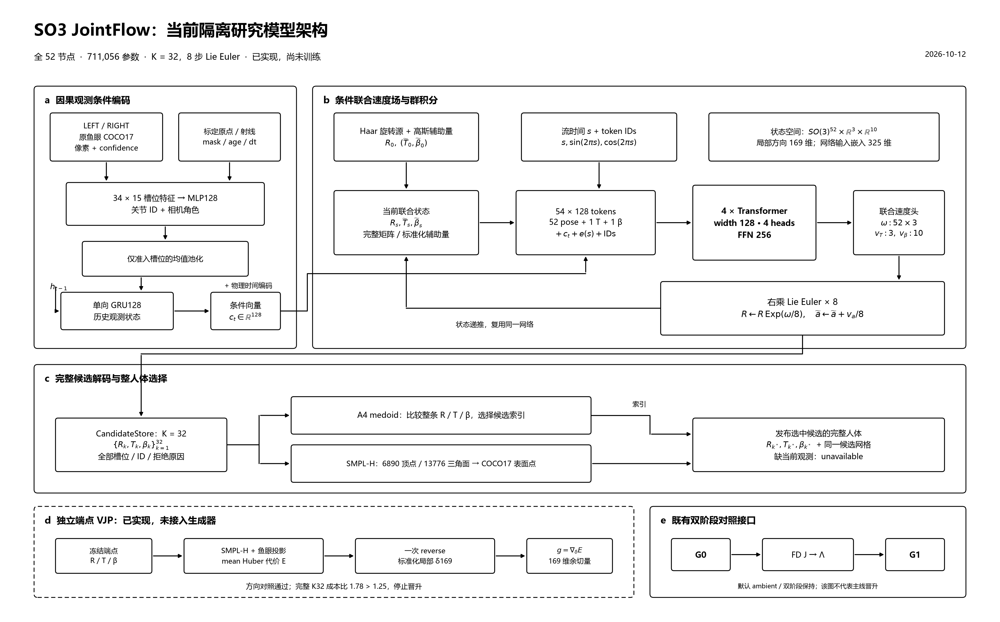

# Flow Matching 隔离模型架构：当前实现与维护入口

本文件依据当前 `realtime_app/learning_flow_mesh_next/` 源码维护。对应的逐项实验条件、数值、失败和解释见 [MODEL_RESULTS.md](MODEL_RESULTS.md)。二者不替代 AGENTS.md、AI_PROGRESS.md 或局部实验协议。更新时间：2026-10-13。后续改变模型、输入、状态、信息编码、输出或评价接口时，应同步修订对应段落；保留旧结果的版本与条件，不能改写成新模型的效果。

最新架构收敛见第25节：采样的冻结信息编码每次调用仅计算一次；推理默认不执行研究诊断；时序状态验证及目标归约各归并为一个实现；D13–15已修复。网络容量、训练状态和正式工程主线身份未改变。

对照SMPL-H主线的定向修正见第27节：H2回放恢复原始二维支持与严格几何门的分离，聚合按活跃目标解码/投影，缺失点在投影前隔离。仅修正有具体来源合同或反例的问题；没有搬入整段共享体型、接触先验或经验置信度公式。

## 1. 模型身份、范围与证据级别

当前研究实现为 JointFlow：在一个联合状态中表达 SMPL-H 局部姿态旋转 R、人物整体位置 T 和体型系数 β，用条件线性 Flow Matching 建模。当前尚未训练，未加载神经网络 checkpoint。测试中的随机模型只能验证接口、依赖和数学行为。正式主线仍为 PMPose 原鱼眼→严格双目→Stage/动态地面→reference25→WiLoR；本模块没有替换其调用。

必须区分四种身份：

- `learning_flow_mesh/` 的历史 144019 参数模型：曾完成合成训练；其结果是人工任务参考一致性。
- 同目录后续 H8 167955 参数隔离工程候选：具有原生手条件、共享体型与 beta 条件接口；不得将旧 baseline 的训练数值归到 H8。
- `learning_flow_mesh_next/`：本文件主要描述的 711443 参数全 SMPLH52 候选，与前两者是不同网络；尚无训练效果。
- 同目录 `so3_flow.SO3JointFlow` 是显式构造的 F0 表示替换候选；D01存储简化后默认52节点695952参数，显式retain_inactive_information=True保留原711056分配。当前默认工厂和双阶段管线仍构造上述欧氏模型。它同样未训练，不能继承任何历史训练数值。

当前 next 实现没有 RGB 特征提取器、预训练视觉模型、独立手部条件 memory、骨架 parent graph、动态地面或接触损失。观测是 COCO17；全模型输出包括52个局部旋转节点，不代表这些手部旋转已从当前观测中被独立约束或准确恢复。

2026-10-12最新状态：研究单模型候选为第13节的SO3JointFlow，默认ambient JointFlow与既有G0/J/G1仍保留。完整端点物理代价VJP已独立实现，方向对照通过，但全K32成本门失败，未接入生成器并停止该反馈晋升；接口与结果见第14节/MODEL_RESULTS第29节。第2节描述默认双阶段数据流，不能当作单模型SO3候选已启用第二生成器的证据。

## 2. 总数据流

```text
单物理帧 Observation + 上一帧 TemporalState
  → StateEncoder：34个视图/关节槽、准入池化、GRU128、物理时间
  → context[1,128]
  → G0：独立帧噪声 → 8次Euler → K32完整候选
  → 冻结G0 medoid anchor → 局部扰动解码/鱼眼投影 → J → Λ
  → G1：自身观测状态/context + 冻结Λ + 独立G1噪声
  → 8次Euler → K32完整候选 → 各候选自己的R/T/β解码
  → A0…A7对照；正式动作从候选池选择一个完整人体
  → 当前缺观测：不发布；失败/歧义/所有候选保留
```

G0和G1是两个不同模型实例，不是一次网络调用的别名；同拓扑不自动证明初始化、训练数据、优化预算或 wall-time 已匹配。当前 prepare 宣告同 core 容量，真实训练对照未执行。TwoStageInference把G0设为eval且关闭参数梯度；G1保留独立状态。不把选中的人体反馈给观测GRU。

## 3. 输入与坐标契约

`schema.Observation`只接收显式字段，无训练标签、已知根位置、strict XYZ真值或任意额外字典。

| 字段 | 单帧维度 | 含义/约束 |
|---|---|---|
| xy | 2×17×2 | LEFT/RIGHT原鱼眼像素；不得仍处在模型转正域 |
| confidence | 2×17 | 原检测置信度，非噪声协方差 |
| present / quality / geometry | 各2×17 bool | 来源可用、原质量、射线几何标志，三者分开 |
| views | 2 bool | 视图可用，admitted=present∧quality∧views |
| origins / directions | 各2×17×3 | 相机0共同坐标、米；准入方向为单位向量 |
| rejection_reasons | 2×17 | 原失败理由，不静默删除 |
| camera_ids | 2个PnP ID | LEFT/RIGHT顺序，不用Windows数字索引当身份 |
| identity / sequence / frame | 显式 | 人物/序列/原帧身份；frame非负 |
| timestamp / timestamp_kind | 秒/来源 | 物理时间；view timestamps可分别保留 |
| operator / units / pixel_domain | 固定声明 | COCO17_SURFACE_REGRESSOR_6890 / metres / raw_fisheye |

present槽必须有限；真正缺失槽可NaN，不能把present但质量拒绝的NaN悄悄归零。几何只在admitted∧geometry的槽输入。当前真实重放的时间是host read返回时间，不是曝光时间或硬件同步误差证明。

H2存档适配器的具体映射于2026-10-13修正：present与quality均继承原逐视图observation_mask（有限且在原图内的像素支持），geometry继续继承原strict geometry_mask。该存档没有额外独立二维quality字段，不能把双目strict_gate冒充它。三角化拒绝不再抹除仍有效的二维条件；未关联人物、原像素缺失及严格几何拒绝仍保留。此处的二维可用不等于高置信或正确，详见第27节。

## 4. 观测与因果状态编码

源码 `state_encoder.py`：每槽15维，顺序为xy2/1000、confidence1、origin3、direction3、present1、quality1、有效geometry1、log1p(incoming_age)1、prior_seen1、dt1。D08修复后，incoming_age是上一状态age加当前dt、但尚未因本观测清零的测量间隔；prior_seen是在当前观测之前是否曾见过该槽。xy/score仅在admitted时进入；射线仅在有效geometry时进入。除以1000是固定输入尺度，非训练得到的图像归一化。

34槽经Linear15→128后加17×128关节身份与2×128视图角色参数，再经GELU、Linear128→128。身份必须在非线性之前与内容结合；旧版MLP后相加会在均值池化中丢失槽位与观测的对应。2026-10-12修复仅调整既有算子顺序，参数仍不变。只有准入槽参与均值池化，池化观测经GRUCell128→128更新hidden。没有准入槽时完全不更新hidden；年龄按dt增加，不发布人体。初始hidden/age为0，seen为False，未知age由seen明确区分。

另一个时间分支输入 `[dt, mean(age), admitted_fraction, seen_fraction]` 的log1p值，经Linear4→128、GELU、Linear128→128。context=hidden+time_context；全缺失时context可因时间变化，但观测hidden仍冻结，不能混淆这两者。

D08修复区分两个时间位置：local MLP读取重置前的incoming_age/prior_seen；返回TemporalState与上述global timing仍使用本次观测后的age/seen（准入age0、seenTrue，缺失age继续增加）。旧实现在清零/置True后才构造local特征，所有实际池化槽位的age/seen恒为0/True。新顺序不增加参数，不改变age/seen或GRU的更新方程，但hidden/context数值因收到新信息而合法改变。旧版本已保存的hidden/模型输出不作为新版本结果使用；已有历史成本不改写成新输入语义性能。

TemporalState保存identity、sequence、camera_ids、hidden128、age2×17、seen2×17、last_timestamp和last_frame；身份/序列/rig改变必须显式reset。时间和frame严格递增。序列化/分块carry保存真实状态，detach用于截断梯度而非清空状态。模块不处理未来帧，不用最终选中候选更新这段memory。

## 5. 联合状态、token与速度网络

全SMPLH52输出维度 D=52×6+3+10=325，决策局部切空间维度 M=52×3+3+10=169。BODY22部分模型D=145、M=79，不能作为完整手部/SMPL-H网格结果发布。

6D旋转为局部旋转矩阵前两列打包；线性流在欧氏6D参数空间进行，不是SO(3)上的Riemannian flow。最终经guarded 6D→matrix转换检查；退化/非有限候选保持拒绝状态，不能凭旋转转换给出真实姿态准确性。

一个样本包含52个pose token、1个position token、1个shape token，共54个token。pose Linear6→128；T Linear3→128；β Linear10→128。加可学习54×128 token IDs、同一context和流时间embedding。流时间s的特征为[s,sin(2πs),cos(2πs)]，Linear3→128→GELU→Linear128→128；一个联合样本所有状态块共用s。

4个TransformerEncoderLayer：width128、heads4、每头32维、FFN256、GELU、dropout0、batch_first=True、norm_first=True。attention在同一帧人体状态token之间进行；跨时间来自前述GRU，不是双向时间attention。pose输出Linear128→6共享于52token；position输出128→3；shape输出128→10；拼回325维速度。

## 6. 参数与容量账本

下表为本轮构造随机模块并计数的结果；没有前向采样、优化或神经权重加载。两个信息编码模式参数数相同；固定probes是非训练buffer。

| 模块 | 学习参数数 |
|---|---:|
| StateEncoder | 137216 |
| pose_in | 896 |
| position_in | 512 |
| shape_in | 1408 |
| token_ids | 6912 |
| flow_time | 17024 |
| info_pose | 1152 |
| info_position | 1152 |
| info_shape | 12800 |
| 4 velocity Transformer blocks | 529920 |
| pose_out | 774 |
| position_out | 387 |
| shape_out | 1290 |
| 全52节点总数 | 711443 |

BODY22部分模型707603。两个G0/G1全模型若同时保存，共1422886学习参数，不能只报单模型容量。每帧16次velocity batch调用，G0/G1各K32×8，共512候选状态求值；解码/J成本另计，不因为batch调用16就称16个候选求值。

## 7. G0局部观测信息与G1条件

`geometry_information.py`选择数值合法G0候选的A4 medoid作为anchor，冻结其R/T/β。局部坐标是右乘局部旋转Exp扰动、位置和beta扰动，使用明确TangentScale；旋转每块要求等方尺度。真实surface decoder输出6890顶点，再由COCO17回归器投影至原鱼眼像素。

J为原admitted像素相对于标准化局部169维坐标的中心差分，完整34点时68×169。默认精度审计float64、step1e-4，时序性能旧检查float32 step1e-3；一个anchor加正负169扰动为339个解码状态，按chunk批处理。Λ=JᵀWJ，W是每view/joint的2×2precision块对角；不包含跨视图/时间误差相关性。当前sigma10px是proxy，calibrated=False，不由confidence直接推成协方差。

默认 `diagonal_blocks`：每pose和T读取对应3×3对角块展开9维；β读取10×10展开100维；signed_log(x)=sign(x)log(1+abs(x))，经无bias Linear9/100→128加到token。信息detach，G1不反传至anchor/J；同一帧Λ被全部候选共享。默认表示不能传递跨块耦合，不能将其称为完整联合观测信息。

可选 `cross_block_sketch` 保持9/100输入宽度，以固定Rademacher probes投影非对角行，再signed-log叠加。3列pose/T probe和10列β probe种子固定，不消费模型初始化RNG，float64全模型17576bytes buffer。该模式已因固定anchor的重建可见性筛选暂停晋升，仅保留数值对照，不是默认。没有无损或JL保证，不能称已改善预测。

Sβ=Λββ−Λβu pinv(Λuu)Λuβ只作为局部诊断；Gram会平方J条件数，截断阈值可产生虚假残余shape信息，需直接whitened-J SVD和阈值审计。局部rank不证明共享beta可辨识或真实准确。

冻结信息保存当前观测、mask/ray/时钟、实际K/D/R/T/图像尺寸/PnP角色及噪声precision/source/calibrated快照。同frame但实际输入改变必须回退。新缓存记录当前观测快照；旧缓存明示legacy_unverified。不认证全历史、decoder资产内容或源数据独立性。

## 8. 训练目标与未执行配置

标准化目标x来自完整标签R/T/β；Normalization仅允许train真实声明统计，工程fixture单位常数不是训练配置。ε~N(0,I)，s~Uniform[0,1]，z_s=(1−s)ε+sx，目标速度x−ε。L=(mean_pose MSE + mean_T MSE + mean_beta MSE)/3，各块按自身维数平均，避免312维pose自动压过3维T与10维β。

2026-10-13 D10.1修复Normalization统计合同：fit仍用原mean/std和1e-4 floor，但结果detach；序列化保留dtype/split/source_kind。训练来源声明只能是train+fitted_reference/independent_reference，工程常量明确engineering_fixture+analytic_fixture，旧四字段记录保持legacy_unverified、原float32默认，不能由source字串自动认证训练来源。require_training_statistics检查声明，不认证独立数据或划分。float32/64回读值逐值保持；mean/scale必须冻结且同dtype，推理入口和回归loss明确validate，SO3 codec绑定来源字段，候选provenance保存这些字段。数据统计真实性仍待真实loader与注册数据证据。

同capacity regression使用同速度网络、输入状态0和s=1，经block平均MSE。2026-10-12已补齐可选information接口：regression、regression_loss与train.objective透传同一冻结Λ，复用原信息投影和全部参数；默认不传Λ与旧输出逐值一致。损失接口已支持信息条件回归；2026-10-12补齐candidate_store.infer的Λ透传；2026-10-13补齐TwoStageInference(..., regression=True, k=1)的原G0/J获取加回归第二阶段入口，保留拒绝/状态并计入全部获取调用。完整训练评估runner未实现，尚未训练；如比较G1，仍须匹配G0生成anchor/J的完整成本和条件来源，不能只匹配单网络参数。CFM没有默认endpoint MSE、best-of-K loss或独立网格损失。

预置AdamW、lr3e-4、weight_decay0.01、clip1、warmup1000、cosine、effective_batch16、unroll32、smoke2000/main50000、validation每1000、seeds7/17/27。`train.py`已有configuration/prepare/objective、D10.2因果SequenceChunk→sequence_objective及D10.3注册train NPZ→原行chunk读取接口；真实注册数据仍0条，无optimizer循环/训练checkpoint生命周期，预置训练计划均未执行。用户未授权训练、motion labels未取得，不能凭配置或可微目标声称可学习性或完整复现。

## 9. 候选采样、解码与发布

默认K32、Euler8、无TTA；z←z+v(z,s,context,Λ)/8，起点标准高斯，终点反归一化。帧噪声由identity/sequence/frame/stream/candidate index产生稳定seed；K1/8/32/64共享前缀、帧之间独立，G0/G1 stream分开。无拒绝后补采样、无旧结果混合。

CandidateStore保存raw、全部R/T/β、numerical/actions、原reasons、ids/seeds、topology、provenance/resources，缓存独占创建不覆盖。当前actions=numerical∧current_observed；预定的额外观测一致性校准动作门尚未实现/校准。投影不可用可导致几何成本inf，但不能冒充已完成独立动作quality gate。

SurfaceDecoder使用已有male SMPL-H/MANO统计资产；每候选自己的β/T解码，不平均β、不拼不同候选关节。physically静态体型的当前估计允许随证据变化，但未实现独立稳态beta认证，也不把EMA beta缝接到另一pose。

## 10. 全候选决策与时间规则

| 方法 | 当前实现 | 可输出完整人体 |
|---|---|---|
| A0 | 原第一个候选；不是第一个可用候选替代 | 原候选可作为action时是 |
| A1 | absolute COCO17坐标均值 | 否，诊断 |
| A2 | 最低原鱼眼观测成本 | 是 |
| A3 | 逐关节JPMA/top-k RPEA工程改写 | 否，诊断 |
| A4 | 完整R/T/β距离的medoid，均值距离 | 是 |
| A5 | 等方二次风险+相同几何成本，均值平方距离 | 是 |
| A6 | B二次风险+几何成本 | 是 |
| A7 | A6近等价动作内的因果时间选择 | 是 |

B=λ0(Λ+λ0I)⁻¹，是决策metric而非后验协方差。δ_kl使用两候选最短SO3对数，运输到anchor切空间，并含标准化T/β差；期望l涵盖所有数值合法原候选，不能只对动作子集重归一化后隐去其余状态。Rk=mean_l δᵀBδ+λg Eobs(k)。Eobs为准入点原鱼眼白化Huber成本，threshold3；没有GT-root/DA3/calibrated posterior weights。

当前Eobs仍按本帧准入view/joint数取条件均值，分母不是固定34；这与SMPL-H可靠程度目标的固定归约不同。A1只需要surface解码，不做投影；A5在λg=0时连surface也不调用。A2/A3和λg>0的A5才要求原观测、rig、noise和surface。observation_errors只投影准入槽，返回uv中未请求槽为NaN、projection_valid为False；准入投影无效仍令对应成本为inf。调用者不能把未计算投影当成全人体视野诊断。

2026-10-12修正该Huber成本的零残差反向边界：平方残差在二次区间时，未启用的线性分支使用安全平方根输入，避免sqrt(0)的无限导数污染where反向。前向Huber定义、原始投影/准入和决策规则不变；精确匹配点的代价与一阶导数均为零。此修复只保证相关数值边界，不代表物理反馈架构已经接入。

A7只在Rk≤minR+validation delta的近等价集合中最小化相对上次发布完整人体的距离/dt²；gap>0.5s关时间偏好。delta0对照保持A6，不能凭这一无变化检查证明时间提升。近πchart、失效信息或实际绑定失配明确回A4，保留歧义/理由，不静默平滑或回写历史。低risk gap非真实物理歧义概率，当前ambiguity未校准。

## 11. 离线评价层与尚缺资源

`evaluation_contract.py`按train原参考分别标准化own-T COCO17和同basis beta10，ES采用固定K V-statistic；raw/legal/action分开，coverage90与width并报。未知参考块unavailable，非法raw池不拿legal分数冒充。`acceptance.py`根据每block三seed配对记录推导收益与CI，不接受直接填true的认证。

`evaluation_population.py`核登记人物/原动作/序列划分、原frame、block分区、source/rig/stratum与train统计origin。`evaluation_blocks.py`从每原帧两方法报告生成完整block均值；任意缺失失败阻断整体配对evidence，原报告仍保存。登记元数据不认证报告对应真实tensor/files、许可、独立真值、power、实际wall-time或外部test锁。

真实motion manifest records=0；独立原鱼眼像素reference records=0；独立3D与shape scan缺失。AMASS同族许可/sex/beta/hand convention待取得核验；不允许SMPL-X beta直接拷入SMPL-H。360重放观测不是训练真值或heldout独立测试。剩余方法收益、三训练seed真实结果、真实校准与实时要求都未完成。

## 12. 文件对应与后续维护

2026-10-12移植审查：作者guidance的端点梯度与经过速度网络回到flow state的梯度并不相同。实际鱼眼project反例中完整GN步虽令线性残差为0，真实残差却增加；合法投影也不能替代下降检验。两个合法旋转的欧氏6D均值可能退化。当前没有接入端点修正/HQS或替换G0/G1，详见MODEL_RESULTS第12节；不可把论文的线性Gaussian理论直接称本模块非线性后验保证。下一阶段先审查冻结局部J计算的自动微分替代及完整成本，再决定是否改变生成器。

直接架构：schema.py、state_encoder.py、joint_flow.py、information_encoding.py。候选与几何：candidate_store.py、body.py、geometry_observation.py、geometry_information.py、tangent.py。双生成与决策：pipeline.py、aggregate.py、information_risk.py。标签/评价：data_firewall.py、train.py、evaluate.py、evaluation_contract.py、evaluation_population.py、evaluation_blocks.py、acceptance.py。

结果描述必须记录：输入范围和来源、model身份/参数/是否训练、seed与候选预算、唯一变量与对照、所有适用指标单位、失败/不可用、统计单位、测时边界、是否重跑，以及结论所能与不能支持的内容。变更后只重跑相关检查，不能用重复绿测试替代真实效果。下一轮在新数据、授权或复现缺陷出现前，不主动扩容或新开无法验收的架构变体。


2026-10-12局部J审计补充：实际SMPL-H两个人工锚点的向量化反向微分与FD导数误差约1e-9，但额外显存约3.4倍、跨运行耗时明显不稳定，且raw AD缺338邻域状态拒绝检查。默认仍为FD；未证实guard等价及完整成本收益，不晋升替换。人工rig实际D=[.03,-.01,.001,0]，v2/v3元数据误写D0的更正及全部测时见MODEL_RESULTS第13节。


2026-10-12邻域门审查：实际local_information的解析边界反例确认“锚点投影合法+AD有限”不等于原FD邻域合法；MODEL_RESULTS第14节保存原拒绝。关闭anchor-only直接替换捷径，暂停局部AD性能替换，不新增边界启发式；后续转回单生成器条件机制的简约性审查。


2026-10-12输入公平性补充：G0的Observation条件不含外部NoiseModel.precision，G1经Λ间接接收；已有码origins/directions不能忽略，也不能等同完整K/D和噪声条件。变化noise的单/双阶段对照必须登记相同可用信息；相同Λ控制需计入anchor/J成本。实际sigma1/2审计见MODEL_RESULTS第16节，未新增条件模块。


2026-10-12 Flower审查不接入新模块：其无条件先验、逐步线性求解与图像样本平均不能直接替代当前观测条件JointFlow及完整人体决策。官方源码范围、默认调用成本和CG停止表达式反例见MODEL_RESULTS第17节。后续文献检索转向直接人体/第一视角条件flow与几何表示。


2026-10-12质量路径候选未接入：StableHand训练/推理起点及发布版时间日程需区分。暂保留同观测起点的条件桥作为简约候选，但COCO17不是完整325D状态，未知beta/手姿不得伪装已知或额外堆proposal网络。解析证据和资源门见MODEL_RESULTS第18节。


2026-10-12起点资源审查修正：部分观测可仅作用于同空间分量，其余q0保留噪声，不要求全325D测量。但硬q1会损失条件源随机性，且WiLoR带来额外输入条件；质量桥尚不接入，继续使用高斯源。详见MODEL_RESULTS第19节。


2026-10-12消融前提更新：用户确认暂无额外数据，训练与噪声参考records仍0；四法Flow/回归×无Λ/有Λ及名义容量/完整成本约束见flow_research_plan_v1.json追加消融和MODEL_RESULTS第20节。仅修复信息回归infer透传，不据接口通过提升模型效果。


2026-10-12骨架流形移植门：同beta两合法姿态，51内部FK边长度变化约数值零，8条COCO表面边最大变化6.4614mm。因此不额外施加COCO骨长恒定，不用骨架一致性宣称SO3概率流。ManiPose作者代码/范围与实际解码反例见MODEL_RESULTS第21节。


2026-10-12SO3概率路径门：当前shortest_log用于局部风险，近π整张量拒绝，单位旋转端点反向Jacobian非有限；冻源/目标的时间JVP仍能有限。不能直接作为全局可微log移植，保留原决策回退；RFM仅为表示替换候选，源测度/速度metric/积分与成本须独立核验。详见MODEL_RESULTS第22节。

2026-10-12专用SO3实现门：FrameFlow legacy 的近π log分支在所检验的固定端点上未满足端点一致性，停止直接移植；其冻端点时间JVP检查实际通过，不能据端点误差泛称时间导数失败。训练的目标中心IGSO3与推理Haar源、线性/指数日程须分别登记。独立SciPy冻端点log加matrix_exp只作为无需拒绝/重采样的训练路径控制通过；没有新增神经网络或改变当前325D模型。下一步只考虑在同条件单模型对照中替换旋转表示与积分，保留相同观测/预算和强回归；不复制蛋白质全局中心化、IPA或其它模块。详见MODEL_RESULTS第23节。

## 13. SO3JointFlow：单模型旋转表示替换候选

2026-10-12按已有长期协议先登记该因素，再实现 `so3_flow.py`。构造时必须传入现有Normalization和ModelConfig；StateEncoder、54token、128width/4heads/4blocks、T/beta输入输出及观测信息保持现有设计。仅pose_out从128→6改为128→3。角速度只表达方向变化，旋转长度和正交关系由群更新维持。旧单模型F0和SO3候选是两个表示对照，未将当前G0/G1/J删除。

数学状态为SO3^N×R3×R10，内部网络仍读取旋转矩阵前两列的6维嵌入，T/beta为原标准化量。速度为3N+13维：52节点169，22节点79。每步右更新 R_next=R·Exp(dt·skew(omega))，T/beta保留Euler。实际携带完整3×3矩阵；默认旋转指数核经第26节检查后使用Rodrigues，显式rotation_kernel="matrix_exp"保留原核对照。速度维度减少本身不代表内存或运行成本降低。

训练和采样均从同一Haar SO3源开始。现有每候选seed及6N+13 Gaussian噪声接口复用，每节点只取前4个独立Gaussian并归一化为wxyz四元数；另外2个分量不进入动力学。四元数到矩阵不取近π拒绝门、不重抽；外部零/非有限源显式报错并给出索引。训练路径使用冻结端点SciPy principal log及R0·Exp(t·omega)，训练路径/sample/regression复用Rodrigues闭式核，线性日程与推理一致。CPU目标准备需要传输与求log，不能作为端点可微guidance接口或训练加速结论。

CFM三块等权：固定1rad单位下每角速度坐标MSE（SO3 canonical metric的常数缩放）、标准化T3和beta10 MSE。确定性对照使用同一SO3网络，一次前向预测相对I的角向量并Exp成合法旋转，再调用现有regression_loss；其标准化6D损失与角速度CFM损失不用于横比效果。两种目标参数完全相同。第24–29节检查时的原分配版本52候选711056参数、22候选707216，均比对应ambient模型少387，其中15104个信息投影参数分配但不激活。D01进一步移除这些不可达分配，默认52/22为695952/692112，旧模式显式保留；活跃计算与梯度逐值相同，任何Lambda输入仍拒绝。

公开输出按绑定Normalization导出完整6D/T/beta，沿用CandidateStore的完整候选、原掩码、缺失观测禁止发布、来源和seed。objective与infer增加显式codec检查，防止另一套均值/尺度把合法列错误解释；资源标记LieEuler和表示身份。现有prepare/config、训练开关、作者代码及正式主线未修改。相关20项测试与改动文件Ruff通过；无训练、权重加载、真实网格效果或速度证据，详见MODEL_RESULTS第24节。

2026-10-12固定预算成本已测，见MODEL_RESULTS第25节：同K32/8调用、真实SMPL-H解码及A4决策，SO3matrix_exp完整p50为44.87ms，对照35.20ms，1.2747倍未过预注册1.25门。少387参数和169维速度未给当前实现提速；候选继续隔离，不晋升。后续最多一次有数学依据的指数核替换，不改变模型、源或日程。结果属于固定人工观测/随机网络成本，非正式系统速度或精度。

2026-10-12第二轮核替换已完成，见MODEL_RESULTS第26节。Rodrigues用K²=wwᵀ−||w||²I及half-angle sinc省去通用矩阵指数；θ²<1e-4用四阶A/B Taylor、regular分支先clamp再sqrt，避免零角 inactive 分支的除零/导数非有限。网络参数、噪声源、日程和步数不变。17项相关测试通过；同次全链p50闭式38.33ms、旧核43.63ms、ambient33.23ms，1.1536倍通过成本门，仍慢于ambient，显存增量未下降。保留显式构造的研究候选；两轮已耗尽，结束核优化，未将其晋升默认、宣称精度或改变G0/G1/J。

2026-10-12统一机制阅读见MODEL_RESULTS第27节：FMPE/条件transport支持当前F0的离线joint配对、在线无G0/J采样，但该通用机制已有先例且数据/噪声充分性未满足。SBI-SIM另加控制网与逐步物理反馈，当前不叠加；当时提出单次晚阶段代价/角向VJP替换anchor信息输入的假设，现已完成独立算子而成本晋升失败，见第14节。A6不等同后验校准/密度/MH，当前无log_prob或真实prior/likelihood；不根据论文的density/覆盖论证升级证据。训练和默认架构继续保持。

## 14. 独立端点代价余切量：已实现，未接入神经网络

`geometry_information.endpoint_cost_vjp` 接收当前完整CandidateStore、严格绑定的原鱼眼Observation、Camera、NoiseModel、TangentScale及独立逐行surface callable。只允许SMPLH52，K个原槽位输出gradient[K,169]、available[K]、costs[K]、原ID/原因、绑定快照和实际解码/reverse计数；不改actions、不选anchor、不建立J或Λ。缺失/过期绑定与无当前观测在解码前不可用；数值非法计算行先排除，全部原输出槽位保留。准入投影失败、非有限代价/梯度及批异常明确记录，unavailable梯度NaN，合法零梯度available。

对每个冻结端点(Rhat,That,betahat)，只对零标准化delta169求导：R(delta)=Rhat Exp(S_pose delta_pose)，T(delta)=That+S_T delta_T，beta(delta)=betahat+S_beta delta_beta。复用Rodrigues右乘核，不用可微log；端点、观测、相机、precision和尺度全部detach。E是当前准入点mean Huber原鱼眼代价，对候选E求和一次reverse，使每行返回各自gradient，不被K缩小。二次区g=JᵀWr/N_admitted；全局真实LBS逐样本独立是批求和成立前提。

该输出是标准化坐标下的代价梯度/余切量。将它变为更新需要明确metric/步长/日程；本阶段没有物理修正、control网络或velocity条件接口。它不能保留Λ的rank/Schur/全耦合，也没有验证FD邻域，不能作为旧information的语义等价替换。

晚阶段s=7/8沿base velocity预测到s=1，正好等于原8步LieEuler最后一步端点，不额外调用速度网络。成本可行性因此在原端点上测旁路；VJP解码仍不能冒充任何未来修正后人体的最终解码。一次真实CPUfloat64对照relative_error=3.9459897e-11、pose/T/beta均有限；同次CUDAfloat32 K32/8完整p50无VJP45.61805ms、有VJP81.30155ms，ratio1.7822233>1.25，停止全K32晚反馈晋升。后者实际网络8batch/256状态、人体2batch/64状态、reverse1；前者人体1batch/32状态、reverse0。详细记录和边界见MODEL_RESULTS第29节与flow_next_endpoint_vjp_cost_v1.json。训练、神经checkpoint和正式主线继续关闭/不变。

## 15. 当前研究方案架构图与阅读顺序

按用户要求生成第24–29节原SO3分配版本对应的中文论文风格图：[可编辑SVG](figures/jointflow_so3_current_20261012.svg)、[矢量PDF](figures/jointflow_so3_current_20261012.pdf)。白底黑线，中文字与数学符号已实际查看PNG并修正；不使用历史H8图替代next，也不添加当前不存在的RGB、手部memory、运动树图、contact或控制网络。该图保留D01/D08之前711056参数及旧时间输入语义版本；主模块连接不变，当前默认容量以第1/13/16节、当前age/seen语义以第4节为准，不覆盖历史图或成本。



图a为原鱼眼34槽位特征的准入池化/观测GRU/时间条件；图b为Haar源、54tokens联合速度场与8步右乘LieEuler；图c保留每条候选完整R/T/beta、真实SMPL-H解码及A4整候选选择。图d明确为独立端点VJP算子，未回连生成器且成本门失败；图e表示既有ambient G0/J/G1对照仍保留，不代表单模型SO3内部包含两个生成器。图中参数与模块来自当前源码，不代表已训练、已验证人体精度或正式主线切换。

当前研究计算链为Observation/历史观测状态→context128→条件SO3JointFlow→K32完整候选→真实解码与整候选决策。旋转读取6D嵌入、实际携带3×3矩阵，输出3D角速度；T/beta沿标准化接口，公开状态325维、局部方向169维。物理人体beta应跨时间不变，但next未实现H8的prefix冻结；当前只是联合生成每帧的beta估计。仅COCO17观测也不直接提供独立手部/shape标签。下一项研究应先证明这种条件分布与整候选决策的任务价值，而不因图形完整或SO3合法就认定创新/有效。

## 16. 长期不足台账与逐项改进协议（2026-10-12）

用户新授权：分析现有模型不足、逐项改进、详细记载，作为当前聊天的持续目标。使用continuous_thread_goal，不恢复定时任务。训练/神经checkpoint、正式主线及独立效能门继续沿用既有授权；“逐项改进”不授权以新增模块代替证据，也不将每一项待验证设计都当作已证实缺陷。

证据等级：源码确认=当前确实存在的接口/实现边界；实测失败=已按协议发生的失败；设计假设=存在合理反例或风险但未证明降低任务效果；资源限制=需要独立标签/训练/部署条件才能解决。排序按明确风险、可判别性和现有资源，先实现可证实的小改进，再决定哪些研究假设值得投入。每项更新保留输入/代码/唯一变量/对照/成功与停止标准/原失败/实际结论，结果统一追加MODEL_RESULTS、协议和AI_PROGRESS；不新建审计/验收文档。

|ID/顺序|不足及当前证据|具体改进或判别动作|成功标准与停止条件|当前状态|
|---|---|---|---|---|
|D01/P0|SO3 F0拒绝所有Λ，却继承15104个info投影权重和固定probes；so3_flow.py/joint_flow.py，源码确认。|移除SO3默认常驻的不可达层/buffers，保留显式legacy分配对照；不动ambient G0/G1。保留构造RNG顺序，对比全部活跃参数、完整候选/状态、CFM/回归值及梯度。|52参数695952、22参数692112；全部活跃计算逐值相同、拒绝语义不变。若需广泛重构或隐式checkpoint迁移则停；只证明存储简化，不测时追分。|已完成存储简化；25相关测试/Ruff通过，MODEL_RESULTS第30节。|
|D02/P1|34槽经均值池化/GRU到context128，人体tokens接共同条件；实际局部关系受损未证。第32节窄102D像素/score输入三seed局部满列秩，初始化敏感性不均。|区分输入自由度、全局非单射与训练后任务充分性；保留原结构，不从34×15原特征槽数推导必须扩容。身份路由仅为数学控制，未移植。|当前结论排除“均值池化/128维本身已经证明该输入范围丢信息”的理由；不认证全局/实际ray/history信息充分，真实对照仍需数据。|维数直接扩容停止；原结构保留，效能问题待独立训练/数据。|
|D03/P1|next定义当前帧联合候选，没有跨帧joint law或显式beta carry；编号不是轨迹。静态真实体型不要求各时刻后验估计相同，实际劣化未证。|已补infer/cache采样范围声明；解析对照拒绝直接嫁接H8冻结、旧beta拼接及仅复用随机种子。保留逐帧模型；共享shape须配套条件/序列生成和同信息对照。|独立shape/姿态效能才可晋升；不泄漏未来、不回写、不以平滑证明收益，当前声明不称真实后验。|合同阶段完成，第36节；共享序列模型与真实效能仍待数据/训练。|
|D04/P1|COCO17输入、52旋转输出，但无独立手部/shape监督和验证；源码及空manifest确认。|逐项声明可观察输入与标签范围；BODY22只能作部分输出对照。额外WiLoR/RGB是信息增加，必须另登记匹配输入，不自动叠加。|取得同family/basis/手均值的真实完整标签并独立评价；不以合法手旋转或表面投影证明真实手姿。数据未获则效果项未完成。|资源限制，暂无新数据。|
|D05/P1|F0缺外部precision、G1经Λ接收的边界已确认；原双阶段只生成，R_info仅有单矩阵原语，不能统一执行获取成本对照。|已接TwoStageInference回归第二阶段，共享原G0/J/noise并计入实际获取调用。固定/变化noise协议仍区分，confidence不当协方差。|信息来源与完整成本必须明确匹配；R_info须独立回归训练，不把接口或proxy噪声认证为后验/效能。|同信息完整推理入口完成，第37节；变noise共同条件与校准/效能待资源。|
|D06/P2|默认Λ对角块丢交叉耦合，固定sketch非单射且原晋升已停；实测反例/第7节确认。|优先问任务是否需要Λ及其耦合，而非不断扩展编码；继承Flow/回归×有/无Λ对照和全部anchor/J成本。|按原held-out门证明收益，不能用sketch重建可见性代替任务效能；不恢复已停跨块扩展。|保留对照，未证明信息必要性。|
|D07/P2|A4 medoid表达候选群体代表性，不保证最接近真值；算法语义确认，真实误选率未知。|同缓存对比最强可部署决策、保留全槽位与风险覆盖；检查多模态及候选偏置，禁止oracle根位置/逐关节拼接。|原选择误差至少5%配对改善及保留率门；无独立真值不选赢家，不新加learned ranker。|待独立效能。|
|D08/P1|原local特征在准入age清零/seen置True后构造，实际池化槽的这两维恒定；6组context精确碰撞及真实时间顺序检查确认。更广的连续时间/运动建模仍未证。|local MLP改用incoming_age/prior_seen；输出状态与global time沿原重置规则。无新参数，不添加hidden衰减或人体结果反馈。|重现间隔/首次见到差异，并保留缺失/未来/分块合同；context响应不等于真实姿态收益。|本地特征缺陷已修复，MODEL_RESULTS第31节；实际缺失/采样节奏效能仍待独立验证。|
|D09/P0|SO3生成仍慢于ambient；全K32 VJP比1.7822超过1.25；第26/29节实测。|保留SO3表示候选，停止现全K32反馈晋升；若有全新有据替代问题先预注册。原核两轮额度不重置。|必须在原K/NFE和全成本口径内达门；不能减K/步数或反复测时制造通过。方向通过不算精度或速度收益。|原路径停止，独立VJP保留。|
|D10/P1|原train.py只prepare/objective，无因果标签帧连接、真实loader/optimizer/checkpoint；原统计grad与回读来源/dtype缺陷确认。|D10.1固定统计；D10.2连接标签帧绑定→因果目标/TBPTT；D10.3注册train文件读取；D10.4 observation-only冻结G0/J获取与原行G1目标连接，保留信息失败/成本。D10.5已接多stream独立carry及监督帧加权批目标；optimizer/checkpoint与真实资源仍缺，训练禁止。|真数据来源、train-only统计、同条件回归、验证选点与test锁均落实；声明不认证真实性，缺资源不伪造已训练成果。|D10.1–5准备接口完成，第39节记录批目标/状态/加权和真实文件连接，21新检查分次覆盖。真实records0，来源/历史/资产不认证真实性；完整训练生命周期/runner及效能未完成。|
|D11/P0|训练、独立noise/3D/shape记录为空，未证实生成/shape/选择/校准改善；manifest确认。|取得独立资源后按原energy score、选择误差、coverage-width、无效率和三seed参与者配对协议评价。现有拟合结果不自证准确。|继承原5%改善、CI/coverage/失败门；数据缺口不能靠工程测试补齐，长期目标保持未完成。|资源限制。|
|D12/P2|当前无后验密度/可信likelihood/校准；全链采集+检测实时与跨rig外推也未认证；源码/既有成本范围确认。|校准/概率与部署分别在相应数据/硬件/完整输入边界评价；先明确采样分布、失败率和时间口径。|不把等权候选、B矩阵、合法旋转或纯网络耗时叫后验/30fps；无证据保留明确未认证状态，不叠加density/MH模块。|待独立概率/部署验证。|

D01的竞争解释为：不可达分配可无损删除；存在隐藏依赖；输出差异其实来自构造RNG偏移。唯一变量为SO3 inactive信息层/buffer分配。保留原super构造和姿态头初始化顺序，显式retain_inactive_information=True作为旧分配模式；默认删除分配，不改变函数、观测、Normalization、Haar源、8步或完整候选接口。严格state_dict不自动忽略旧层，旧已保存结果继续按原容量解释。当前所有下一项均为待判别/资源状态，不能提前写成改进完成。

D01实际通过：默认SO3删除info_pose/info_position/info_shape，并将非持久pose/shape probes置None。原ambient构造不变，profile共同参数复制只取两个模型实际共有的keys。构造仍先创建旧层再移除，保持活跃参数初始化逐值相同，故不宣称减少初始化峰值；原分配模式用于历史比较，不是另一个生成器。float32三组权重常驻/serialized张量减少60416bytes，固定probes移除13M个元素（原float64时52节点17576bytes、22节点8216bytes；随to(dtype)改变原buffer字节）。活跃容量不变，无新性能测量；旧strict state_dict在新默认模式显式报unexpected keys，未加入隐式迁移或加载checkpoint。

D08先在现有协议登记时间特征碰撞控制，CPUfloat64 seeds7/17/27、同incoming hidden/观测/时钟，仅一个准入槽的age或prior_seen不同。旧版六组context差严格0，实际0→缺失0.2→恢复0.9秒序列的local输入也错把第一次seen设True。修复后六组context均可区分（测试阈值1e-8），重置后的age/seen/身份/时钟相同，hidden按新观测特征变化；首次age0/prior_seenFalse、恢复gap0.9/prior_seenTrue正确。27相关项先通过；6项因错误要求hidden相同而失败，修正测试约束后仅该6项通过，两文件Ruff通过。共有33相关检查分次覆盖，不重复此前27项。无训练、checkpoint、测时或真实缺失姿态收益结论。

D02限定范围的结果见MODEL_RESULTS第32节/flow_next_encoder_dimension_v1.json。当前帧34个像素对和score共有102个自由连续坐标；掩码/身份是离散条件，射线/时钟在该检查固定，不能把34×15全当独立实数。身份路由到34×3=102坐标并给score加1，mean后可由非零score块恢复准入集合及N，再乘N恢复值；四个例包括零score与全缺失。该控制未加入实际MLP。实际修复后context的128×102 Jacobian在三随机seed和四个阈值均秩102，但smin/smax约6.3–6.6e-7；这些是局部/初始化信息，不证明全局可逆、实际足够或trained误差。保留现有mean/GRU，停止仅凭维数增加cross-attention/RGB/宽度；下一步进入D10真实训练准备接口的资源与因果合同检查，优化与权重加载仍关闭。

## 17. 因果序列目标准备接口（2026-10-13，未训练）

`train.LabelFrame`显式保存目标行的identity/sequence/frame/timestamp/camera_ids；`SequenceChunk`将1–32个原Observation、同数Labels行与LabelFrame绑定。使用现有完整/部分标签mask，类型/拓扑/数量、同一人物序列rig、严格递增原frame/clock、逐行绑定和统计来源在forward前检查。工程分支必须analytic_fixture+engineering_fixture与显式fixture统计；声明train参考必须使用D10.1训练统计gate，validation/test不作为该训练目标入口。上述metadata对齐仍不认证标签来自独立源、实际正确时钟/asset basis/组划分；真实loader与manifest注册尚缺。

`sequence_objective(mode, model, chunk, normalization, state=None, generator=...)`先detach incoming carry，再按原帧顺序调用同一个Observation-only StateEncoder。每帧context只依赖截至该帧的观测；标签R/T/beta及mask切为本帧一行且detach，不送入encoder。只有当前有准入观测且完整标签的行调用原CFM/回归目标，每行一次velocity batch。无观测帧仍推进时钟/age并保留hidden，标签不完整但有观测的帧仍更新hidden，不伪造目标、不从序列删除。

返回`SequenceObjective`含全部原frame绑定、contexts[F,128]、frame_losses[F]、supervised[F]、逐帧unavailable及原观测rejection_reasons、脱图carry和实际frame/target调用计数。正常有监督loss为原有效监督帧的均值；跨chunk/有效batch不能等权平均块均值，应按supervised_count加权。无可监督行loss=None、原槽NaN；已计算目标非有限时保留NaN/原因并将整个chunk loss设None，不选择其他有限行冒充可训练。本节记录D10.2的F0初始接口；2026-10-13 D10.4已接可选G1逐帧信息，来源绑定/获取成本规则见第21节。

块内历史观测→后续loss的梯度保留，块边界的incoming/returned carry脱图，实现TBPTT截断而非重置；没有optimizer、checkpoint读写、文件数据加载或自动训练。5帧原时间[0,.17,.52,.73,1.1]的工程检查含1缺观测、1缺beta、3监督；同种子目标、未来隔离、非均匀分块加权、标签/状态梯度屏障等见MODEL_RESULTS第34节。网络容量不变，所有结果是准备接口证据，不是模型有效性。

## 18. 注册数据文件到因果接口（2026-10-13，真实数据未取得）

`train.load_registered_chunks(manifest_path, record_index, normalization, asset_contract=..., device=..., dtype=...)`读取一个明确注册的train记录；先用现有manifest检查整张登记表的subject/original_action/sequence跨split冲突，再检查许可声明和选中记录。record必须补齐identity、两个明确有序PnP camera_ids、reference source_kind与22/52 nodes；normalization必须通过冻结train统计声明gate。相对source_path以manifest所在目录解析，不扫描其他文件。外部asset_contract与manifest及文件header的family/gender/beta_basis/beta_dimensions/rotation_convention/hand_mean/dmpl声明逐项一致。

NPZ格式`flow_next_sequence_v1`仅使用numeric arrays与JSON文本，allow_pickle=False。原Observation的xy/confidence/present/quality/geometry/views/origins/directions及2×17拒绝原因完整保留；目标为R[F,n,3,3]、T[F,3]、beta[F,10]及显式Boolean masks。原frame_ids/timestamps与另存的label_frame_ids/label_timestamps须逐值相同、严格递增；header明确raw_fisheye、LEFT/RIGHT、cam0_LEFT、metres、COCO17_SURFACE_REGRESSOR_6890与时钟来源，可另存两个原view时钟。禁止整型mask转Boolean、自动重排/补行、pickle或假手/假beta。

按最多32个连续原行切chunk，不按可监督状态筛掉行；Observation/Labels继续使用既有validate/packed，缺失NaN和原拒绝原因仍存在。返回source/manifest路径、全部原frame IDs、组/资产声明及authenticity_verified=False等来源字段。D10.2目标函数与参数容量均未改；它的监督条件、TBPTT、失败及加权口径继续适用。

检查使用pytest临时、明确synthetic_contract_fixture的35帧22/52文件及5帧连接对照，非真实数据：32+3分块保留全部行，文件与独立内存输入的contexts/状态/aggregate相同，逐帧loss按allclose含NaN一致。24个新检查分次覆盖与Ruff通过，失败与命令见MODEL_RESULTS第35节。当前真实训练及独立噪声参考清单records均0，读取真实清单返回registered_training_data_unavailable。声明匹配不认证真实subject/clock/asset basis/标签质量，也不证明统计只由实际train获得；无optimizer或checkpoint操作，完整训练runner和独立效能仍未完成。

## 19. 静态体型、在线估计与跨帧候选合同（2026-10-13，D03）

当前代码的输出记为$q_t(R_t,T_t,\beta\mid c_t)$，其中$c_t$由截至当前的Observation-only encoder产生，$q_t$仅是现有随机采样器诱导的分布记号，不是已认证后验。nested_noise的key含identity/sequence/frame/stream/slot；TemporalState只有观测hidden/age/seen和身份时钟，不携带任何候选beta。ambient/SO3的T与beta均在当前帧联合ODE中更新，完整候选一起选取。固定帧内K8是K32前缀；跨帧同slot并非同一个人的世界状态假设。没有定义一个共享beta的整段轨迹分布。

静态物理参数不等于冻结估计。已知模型$\beta\sim N(0,1), y_i=\beta+\epsilon_i,\epsilon_i\sim N(0,1)$独立时，$\mu_t=\sum_{i=1}^t y_i/(t+1),v_t=1/(t+1)$；真实beta始终一个常量，估计和不确定性仍随新证据改变。对全部数据取期望，冻结第8次后验均值这一估计器的平方误差期望为1/9，更新到16次的估计器为1/17；此为已知标量模型的解析性质，不是人体真实误差。原PrefixSharedShape用固定解析head的检查确认前7行不可用、count8后读出冻结，说明H8确实实施这种政策，不证明该政策更好。

单帧分布不足以推出跨帧耦合：beta取±1，两个时间各边缘均1/2；shared coupling的2×2表diag(1/2,1/2)与independent coupling的四项1/4具有相同边缘，而跨帧不同beta概率分别0与1/2。重新使用同seed也不构成静态shape保证，映射随context变化；若两个时刻beta分布不同，却要求等权同slot样本逐一恒定，就不可能同时保持这两个边缘。静态隐变量过滤可更新权重/粒子谱系，但当前缓存并没有这种协议。

共享轨迹目标须明确为一个beta与全部$R_{1:t},T_{1:t}$的联合分布，并区分“当前时刻重建过去的轨迹”与“已发布在线动作不可回写”。可以依链式法则分解shape分布与以shape为条件的轨迹分布；该数学分解不保证当前速度网络能直接实现条件采样。[HuManiFlow](https://arxiv.org/abs/2305.06968)式8–10/3.6先采shape再以它条件化姿态，但它是单图像方法，H8也不是作者完整复现；不能照搬成next共享序列有效性证明。冻结beta速度、固定seed或把旧beta拼到新pose/T均不是条件分布推导。

本轮仅在infer.provenance新增temporal_sampling：unit=current_frame_complete_candidate，cross_frame_joint_law=not_defined，explicit_beta_carry=False，slot_is_trajectory=False。缓存roundtrip保留字段；旧缓存没有字段时仍未声明，不静默认证。种子、参数、目标、求解、发布和候选选择未改，from_parameters的完整候选beta语义保留。既有cache测试扩展1passed/Ruff通过；解析支持反例、失败访问与边界见MODEL_RESULTS第36节。保留当前逐帧生成，停止无条件冻结/拼接提案；共享序列机制与真实收益保持未完成，训练/神经checkpoint关闭。

## 20. 同信息回归的完整获取路径（2026-10-13，D05）

`TwoStageInference(...)(observation, state, k=1, anchor_k=32, steps=8, regression=True)`执行原冻结G0采样和同一local_information，再调用原infer(..., information=matrix, regression=True)。steps仍控制G0；回归仅1次，不将它重复K次当分布候选。regression默认False沿原双阶段CFM路径；True且k非1在encoder/J前报错。没有修改NoiseModel/precision来源、encoder、core容量、Λ计算或SO3F0拒绝Λ的合同。实际验收为ambient22/52，未扩展SO3G1信息模式。

报告区分generators和regressors及second_stage_objective，network_calls与candidate_state_evaluations为两阶段之和，J_decoder_calls/states沿原Information报告照录。R_info的matched_total_sampling_G0_control_K=None，不能把一个确定性输出加到G0样本数就称匹配生成预算；CFM默认该字段仍anchor_k+k。wall-time仍需实测，不由K数推导。该路径覆盖G0/J/参数推理，不包含相机采集/检测或最终真实网格解码，不能称全系统成本。

两个方法复用相同G0、观测、rig/noise、统计与anchor预算才能构成F_info/R_info输入对照；训练评价时R_info的g1必须独立按回归目标训练，不能把CFM权重切换方法当强回归基线。本轮同随机权重仅隔离接口因子。最小测试验证真实local_information非空、G0 raw/IDs、Λ和观测state逐值相同、回归输出等于手动API、状态恢复/缺失和独立surface调用计数；3新检查及1原CFM检查通过，见MODEL_RESULTS第37节。

固定noise的比较可在共同固定条件下登记；变化noise时F0/R0没有外部precision、F_info/R_info通过Λ接收，仍是输入因素，不得解释为纯生成器数量效应。sigma10px继续proxy/calibratedFalse，真实训练/独立噪声参考均0；2026-10-13 D10.4补齐G1序列目标/原帧信息连接；全四法训练runner、来源真实性与独立效能未完成，不新增precision神经模块。

## 21. 因果序列G1冻结信息准备路径（2026-10-13，D10.4）

`train.acquire_sequence_information(g0, observations, normalization, scale, surface, cameras, noise, state=None, anchor_k=32, steps=8, jacobian_step=1e-4)`只接收1–32个原Observation，不接Labels。g0必须eval且所有参数requires_gradFalse；原观测同identity/sequence/PnP stream、严格递增frame/time、rig/noise与统计拓扑先核对，再在no_grad内逐行调用原infer G0及local_information。缺观测行仍保留G0内部计算/时钟/原因，目标不完整不会过滤观测或信息；incoming/returned G0 carry脱图，分块须传其state。当前一个调用使用同一rig/noise，可在块间明确更换，未实现随意逐帧噪声列表。

`SequenceInformation`保存全部原行Information、原G0资源、实际rig/noise/scale和G0返回状态。`sequence_objective(..., information=bundle)`在任何G1编码前核对全部行数、typed Information、原观测provenance与observation/rig/noise完整快照、scale、冻结matrix/J/anchor、矩阵有限/形状/对称及anchor拓扑、已记录anchor观测绑定状态和非负整数获取计数。复用require_information_binding，不通过固定frame ID替代像素/mask/ray/clock检查。篡改、错帧或旧未验证anchor不回退成可接受信息；SO3F0拒绝整个G1信息接口，原ambient22/52为本阶段实现范围。

合法的matrix=None必须保存原原因；仍调用同一个G1网络的无Λ路径，与既有推理回退一致，不删除原行或用零矩阵伪造有效信息。逐帧reasons另存information_unavailable/anchor_id/noise_source/calibrated，不混作观测/标签失败。仅当前观测可用且R/T/beta标签完整的原行计算CFM/回归，标签和matrix均detach；块内观测/目标网络梯度、TBPTT边界、监督计数加权与非有限目标阻断沿原规则。默认information=None保持F0原接口。

resources.information_acquisition汇总该块G0网络调用/候选状态求值、J解码batch/状态及可用/不可用信息原帧数，computed_in_this_objective=False说明这些工作已在获取入口发生，不能把缓存当部署零成本，也不能将同一缓存用于多次目标计算时误认每次重新获取。目标自身encoder/velocity计数仍独立。返回G0 state用于获取分块；G1 state独立用于目标分块，不能互换。快照与数值计数不认证实际G0训练来源、完整历史/真实资产/组划分或缓存真实性；无训练/权重生命周期/后验认证。

26个新检查和11个原F0相关检查分次通过/Ruff通过：人工5帧、ambient22/52、CFM/回归逐行独立API一致，监督0/2/4、缺观测1、缺beta3保留；G0/J分块、future隔离、梯度屏障、全信息失败回退及前置拒绝见MODEL_RESULTS第38节。实际surface为T-only解析控制，不是SMPL-H精度/shape信息验证；未改模型容量/solver/噪声/选候选政策。真实records仍0，完整四法训练runner与独立效能继续未完成。

## 22. 多序列批目标、独立carry与监督权重（2026-10-13，D10.5）

`train.sequence_batch_objective(mode, model, chunks, normalization, states=None, generator=None, information=None)`连接最多16个原SequenceChunk，每chunk保留原1–32帧；16是当前配置的准备窗口上限，不代表已执行effective_batch优化器。按(identity, sequence, ordered PnP IDs)键分别维护TemporalState，允许Afirst/Bwhole/Alast交错。新stream从None开始、已有stream只继承自身state；incoming字典不改，返回脱图状态可继续下一个batch。epoch重置/重采样/stream退休等执行政策未自动定义，不能把不同stream的hidden混用或把批处理顺序当时间排序。

所有原chunk/标签/统计、同stream跨chunk帧号与时钟、提供carry的类型/key/基本向量健康和可选SequenceInformation绑定在首次编码前检查。validation/test标签仍不能进入训练目标，已重放原帧、坏后行/错信息或超过16窗口明确拒绝。随后每窗口调用原sequence_objective，各窗口已有标签/Λ/梯度/缺失/非有限及TBPTT规则不改。默认F0和可选ambient G1共用调度；SO3F0仍拒绝信息条件。

返回SequenceBatchObjective保存全部原chunk结果、各stream末state及汇总原帧/监督/跳过/编码/目标计数。总损失按监督原帧N_c加权：sum_c (N_c/N_total) L_c；先归一化权重避免有限均值先乘count造成float32溢出。全部无监督时None；任何已计算chunk目标非有限或批汇总非有限时整个batch lossNone，保留其余有限结果与原失败原因供检查，不将它们挑成可用批。此为训练帧权重，不是参与者等权held-out统计，更不平均或拼接人体候选。

可选每窗口信息包仍在外部用冻结G0获取；批入口验证并汇总原G0/J计数，computed_in_this_objective=False，不重新获取，不把缓存计为部署免费。G0获取carry与这里的G1目标carry仍独立。模型容量/CFM/回归/solver/噪声来源均不改，generator按调用窗口顺序消费，改变顺序会改变CFM抽样；未新增shuffle/optimizer/checkpoint执行。

21个新检查分次覆盖：8种ambient/SO3×22/52×CFM/回归对照，A/B独立重启/延续与原逐chunk调用一致、监督2/3/1正确加权；跨batch不修改incomingcarry、坏后窗口前置拒绝、全无监督及真实非有限velocity失败保留；float32 3e38均值控制发现并修复权重中间溢出。临时注册35+5文件22/52连接保留40行/36监督，G1批成本/错信息检查通过；详见MODEL_RESULTS第39节。真实注册records仍0，组/标签/资产真实性、训练授权、完整执行生命周期与四法独立效能继续未完成。

## 23. 当前阶段完成边界与资源门（2026-10-13）

D01常驻不可达权重简化、D08局部age/seen特征修复、D10.1–5统计/原帧/信息/多序列准备路径均有工程证据；它们不代表真实姿态、shape或概率分布改善。D02不能凭窄输入局部秩或仅有128维就新增容量；D03不能默认冻结beta/拼接候选；D09原SO3核两轮关闭、全K32端点VJP因成本失败停止晋升。其余D04/05/06/07/11/12及D02/03/08的真实效能还需相应来源/标签/训练/独立评价，不能用更多工程通过替代。

当前train.py实际只配置/准备/计算目标：有原注册文件读取、因果F0/G1与多stream批目标；没有AdamW构造、optimizer step、epoch执行、权重保存/加载或四法配对训练runner。配置中的AdamW/50k/16窗口均是预置计划。实现缺口与“尚未执行”不同；当前数据来源、许可、family/basis/手均值、参考质量和训练授权尚不满足，执行生命周期待恢复相应环节后实现与验证，不把未运行的循环当已完成功能。

flow_next_config_v1.json原performance_revisions_used=0仍是2026-10-11状态，和较新协议SO3第二轮关闭冲突；本轮改为2/2并明示scope=SO3表示/旋转核成本机制。不是所有研究问题共用两次，而是该已关闭机制不能重置；VJP另按原记录revision1/成本失败停止。旧flow_next_readiness_audit_v1.json和各成本文件保存历史，不覆盖。新增preparation_status把已检查准备接口与未实现生命周期、真实records0/独立效能False分开。

当前资源门：flow_next_data_manifest_v1.json records0/license missing/no_training_labels_acquired；flow_next_noise_data_manifest_v1.json独立reference records0；current task明确training/checkpoint loading禁止，四法计划current_run_results=None/independent_efficacy_establishedFalse。后续保留>=5%能量/选择改善、参与者配对95%CI、强几何非劣、coverage-width/无效/成本与三seed等原门，不降低到内部一致性。现有360帧拟合/原观测不能补独立truth。全链p95<=33.3ms仍未证实，历史小预算/随机模型成本不能称部署30fps。

阶段决策：保持当前隔离候选与正式主线边界，工程准备阶段先到此收敛；实质数据与授权未改变时，停止无效的效能尝试或继续加准备框架。长期目标仍完整且未完成，资源阻碍首次集中确认；目标状态暂保持active，不能在此标complete或首次标blocked。资源变化后先落实登记与来源，补实际执行/验证选点与测试锁生命周期，再运行原配对协议；不能凭现配置称模型更准确、共享序列shape有效或G1必要。

连续三轮确认后的当前状态（2026-10-13）：注册数据/独立noise-reference与训练授权未改变，goal工具已返回blocked；前文首次确认时active为当时状态。隔离候选、工程修复、正式主线边界和完整未完成目标均保留，未声明真实精度或全部不足已解决。执行生命周期/配对runner和独立验证仍须在可信资源/适用授权后完成；本轮只同步记录，不继续追加模块或流程材料。

## 24. 进一步纠错分析：新复现缺陷与研究优先级（2026-10-13）

用户本轮要求仔细分析还有什么需要改正。本轮核对源码并做四个限定人工反例，只更新分析记录，没有修改模型或解除训练限制。第23节的阶段收敛不代表代码无剩余缺陷；新发现如下，均待修复，详见MODEL_RESULTS第41节。

|ID/优先级|源码与复现|影响|建议的最小修正与验收|
|---|---|---|---|
|D13/P2|train.sequence_objective直接对float32逐帧损失求mean；三个有限3e38得到inf，nonfinite_objective仍False。|单chunk调用方收到与状态矛盾的目标；外层batch虽能拦截inf，但不能恢复本可表示的均值。|稳定归约并检查最终aggregate；同一反例须返回有限3e38或明确不可用，禁止inf配正常标志；保留所有原帧。|
|D14/P2|StateEncoder与序列carry检查未验证历史last_timestamp有限；NaN历史时钟绕过递增比较，下一帧context为NaN。|损坏的恢复状态污染后续正常观测，原始原因被后续数值失败掩盖。|在使用carry前统一验证时间/帧ID及状态张量；NaN/Inf历史时钟在前向前拒绝，正常分块连续性保持。|
|D15/P1|acceptance.preregistered_gates按metric取配对证据，未将歧义门绑定到所需stratum；完整登记的strong_geometry_only人工组也使ambiguity改善和CI门pass。|研究分组通过标志可能错误；当前人工证据的总体效能声明仍被blocked_analytic_fixture拦截，不是已发生真实精度误报。|明确门所需的分组/方法/预算/数据划分契约；错误分组应拒绝或not_evaluated，正确登记组再按原数值门判断。|

需要进一步改正的研究设计：

1. **收紧观测能够支持的结论。** 当前单帧几何链为169维局部人体参数q→17个共同三维表面点P(q)（51维）→双目像素（最多68维）。精确局部J=D投影·DP的秩不超过51，完整52节点至少118个局部零空间方向，BODY22的79维也至少28个。这里限定固定相机、当前17点观测与局部一阶几何；不否认训练先验、时序耦合或额外外观能够帮助恢复。有限差分误差/截断产生的表观秩不能突破此解析上界而成为辨识证据。完整手姿和shape仍需相应信息/标签。
2. **明确Λ的作用。** 当相机/噪声条件匹配，Λ由同一观测历史、固定G0与独立采样规则计算时，它没有新增独立测量。它可作为几何特征或有用的计算归纳偏置，但效能必须在同信息和完整获取成本下证明。若G1额外得到变化的噪声精度而F0没有，须区分信息增加与编码机制贡献。
3. **分开两个架构轴。** ambient支持有/无Λ的Flow与回归；SO3当前显式拒绝Λ。原四法主对照和SO3表示对照应分别评价，不能将SO3、G1和新选择器一起改后归因于某一模块。
4. **确定可执行的监督范围。** sequence_objective要求pose/T/beta整帧齐全，缺任一块就不计算该帧目标；BODY22仍需要T/beta且SurfaceDecoder仅支持完整52节点。优先确定实际可获得的匹配标签，再决定完整或明确部分任务；不得填零手姿/体型，也不能简单遮掉CFM目标便宣称学到完整联合分布。优化器、epoch/stream、权重生命周期及四法runner仍未实现。
5. **修正概率评价的解释与执行门。** evaluate.distribution的coverage90是坐标边缘平均覆盖。人工51维例子有46维覆盖、5维始终不覆盖，得到90.196%并通过现覆盖门，但整向量不在区间盒中。原实现对此有marginal声明，问题是不能将该门解释为全身联合覆盖。保留原边缘指标，落实原协议中的宽度/分组/失败报告；若新增联合覆盖目标，应另定义并预注册，不用一个平均数代替。V-statistic ES是固定有限候选集合评分；改变K或过滤候选时明确评分对象，不静默改估计量。
6. **给候选决策明确任务权重。** A4在全部52旋转、T、beta的缩放距离中选代表；弱观测手指/shape的变化可能左右身体输出。是否实际劣化未证，不能凭维数认定；使用同一候选缓存和预先声明的身体/全身决策目标评价，继续选整候选。
7. **将在线必须计算的量与研究诊断分开。** local_information每次获取都做多组Schur伪逆/白化SVD阈值扫描。可考虑最小推理与完整诊断选项，保留必要合法性、来源及失败语义；源码只证明存在额外分解，未测得可省时间。该项不重开已关闭的SO3旋转核两轮或全K32 VJP机制。SO3训练目标还逐帧转CPU调用SciPy旋转log，实际训练前应关注同步成本；目前不凭静态观察宣称瓶颈比例。
8. **序列人体仍是未解决的建模问题。** 当前历史只提供条件，每帧32候选没有跨帧联合采样律；共享shape、身体轨迹与缺观测期间输出须有一致目标/发布政策及独立对照。不能靠固定seed、旧beta拼接或显示平滑补成已完成序列模型。

修正顺序：先D13/D14/D15这些不依赖真实数据的已复现错误；再锁定实际监督范围和四法对照契约；资源与授权到位后补最小训练生命周期并验证生成的任务价值；最后按真实失败决定是否引入序列shape或更多观测。当前仅完成分析与登记，不将上述建议标为已实现或有效。

## 25. 2026-10-13架构收敛：固定条件一次编码，推理与诊断解耦

用户要求以next模型为重心深入分析、改进并减少冗余，且仅作必要逻辑/可运行性检查。本节更新第24节后续状态。当前完成的是计算图和职责划分改进，以及三个确定错误的修复；未选择新的训练架构赢家，未减少Transformer层数或参数量。

### 25.1 当前最小计算链及改进理由

```text
原帧Observation + 经统一验证的TemporalState
  → 观测编码/准入池化/GRU → 当前context
       ├─ 单模型F0或R0：不获取Λ
       └─ 信息条件分支：冻结G0原候选 → 原有限差分J → Λ
            ├─ 信息块编码 + 三个线性投影：本次采样只做一次
            └─ Schur/秩/SVD诊断：仅显式请求时运行
  → 动态状态、共同流时间、context、可选信息token → 原四层速度主干
  → 原Euler步骤/完整R,T,β候选 → 原解码与完整候选选择
```

此图里的F0/R0和信息分支是实验路径，不是要求每个推理同时执行所有路径。G0/G1仍是不同模型和各自的观测状态；不能因输入同源就把它们的GRU权重或hidden直接共用。姿态、T与β共用一个流时间并经联合attention交互，避免任意拼接不相容的人体参数。

设冻结信息编码为U(Λ)，每步动态token为Z(z_s,c,s)。原过程每步都执行U(Λ)，再计算Vθ(Z+U)。U不依赖z_s或s，当前投影无dropout和状态更新，因此可以把U提升到本次sample循环之外。`JointFlow._information_tokens`承担固定条件编码，`_velocity_from_tokens`承担动态速度主干；原`velocity`仍作为单步训练/回归接口组合二者。sample仅在函数局部保存U，不设跨帧缓存，不混用下一帧Λ，不detach投影权重的梯度。反向时各步对同一U的贡献相加，与重复建立相同投影图等价。

默认Euler8的信息编码/三个投影组由8次变1次；速度主干仍8次，K32仍为256个候选状态求值。两种信息编码均适用；无Λ不执行信息编码。参数、初始化顺序和state_dict键不变：SMPLH52仍711443，BODY22仍707603。这里87.5%的减少只指重复的信息编码调用，不能当作总延迟降低87.5%。没有新增性能测量，旧耗时按旧版本解释。

### 25.2 推理必需量与研究诊断各负其责

`local_information(..., diagnostics=True)`保留低层旧调用的研究用途；`TwoStageInference(..., diagnostics=False)`与`acquire_sequence_information(..., diagnostics=False)`默认只获取信息。需要诊断时在同一入口显式传True。

最小路径保留原anchor选择、当前观测/相机/噪声绑定、所有中心差分邻域投影有效性、有限JᵀWJ、原拒绝理由和成本计数。52节点仍计算1+2×169=339个decoder状态，22节点仍159个，不以删邻域检查换简洁。研究诊断移入`information_diagnostics`；完整模式复用已有rtol=1e-6的Schur结果，原6次Schur调用变5次，五个阈值报告仍保留；最小路径不调用该诊断函数。A6/A7自身用于决策的矩阵合法性检查仍保留。

状态明确为`not_requested`、`not_computed`、`computed`或`unavailable`。诊断分解失败记录在diagnostics.reason，保留已经有效的matrix/J；真正信息获取失败仍matrix=None、保留原information_unavailable等原因，并按原规则回退。这样不会因为可选研究输出失败而丢弃可用的推理输入，也不会将未计算的秩报告冒充通过。低层返回字段兼容保留，尚无训练性能或物理辨识性结论。

### 25.3 统一已有边界，修复D13–15

- D13：`train._reduce_objectives`统一序列与批次的监督计数加权均值，用float64累积后返回原dtype，保留梯度并检查最终有限性。3e38反例可返回正确有限均值；未监督帧、失败帧和原计数保留。普通值可能有舍入差异，不要求与旧不稳定求和逐位相同。
- D14：`TemporalState.validate`集中时钟有限性、非负整数帧号、hidden/age/seen形状、有限值与掩码类型。encoder、序列目标、信息获取、整批前置校验复用它，删除原复制的张量检查。坏后stream也在任何batch编码前拒绝，不自动reset或插值掩盖。
- D15：评价仍保留每份证据的数值报告，但先检查其分组/方法/预算/数据划分是否回答该门的问题。错误合同返回not_evaluated并列出gate_contract_mismatches；重复metric仍显式拒绝，不能按输入顺序覆盖。原改善5%、CI、失败率等阈值未降低。

当前机器可读语义名称如下，依据较新的四法对照协议，而非早期“仅拿冻结G0作基线”的说法：

|评价量|stratum|baseline / proposed|budget_scope|
|---|---|---|---|
|standardized_joint_energy|preregistered_ambiguity|F0 / F_info|declared_fixed_K32_shared_acquisition|
|selected_error|preregistered_evaluation|strongest_deployable_baseline / proposed_whole_candidate_risk|declared_same_candidate_cache|

真实声明需test，人工验证需analytic_fixture/engineering_fixture。validation仍可报告数值但不使最终接受门pass。这些名称只绑定语义，不能认证真实预算、最强基线、许可、独立真值或test锁；缺这些证据仍不能宣布效能。强几何非劣等原标量门仍是诊断输入，不被本次改成完整实证认证。

### 25.4 保留什么、下一步才允许改变什么

|结构|当前判断|改变所需依据|
|---|---|---|
|4层width128联合Transformer|暂保留。没有训练后容量曲线，随意减层可能破坏耦合；随机网络可跑不说明容量恰当。|同标签/训练预算下对比2层与4层或较窄主干，任务结果和完整成本共同决定。|
|52个旋转 + T + β的联合生成|保留完整候选合同。手部弱可观测不等于手部可任意补零。|实际只取得身体标签时先明确定义BODY22任务及相应解码边界；不要把部分任务充作全人体。|
|COCO17、射线、原像素与confidence|保留不同语义字段。射线由像素与标定派生，不是额外独立测量，但显式几何可能帮助跨rig。|固定/变化rig的同信息输入消融；不能仅因数学可导出就删掉潜在有用的归纳偏置。|
|准入均值池化、GRU与物理时间分支|保留已有因果结构。历史和当前缺失状态有实际职责，原D08失效输入已纠正。|真实遮挡/长间隔对照后才能决定是否替换为更重的时序attention或额外衰减。|
|G0→J→G1|保留研究对照，但不把双生成器作为必需部署结论。它是最大可疑结构成本，F0/R0已是更简的可执行候选路径。|原F0、F_info、R0、R_info公平训练及固定K32评价；至少5%歧义ES改善和CI及非劣门，计入G0/J完整成本。未执行不支持宣布G1有效，也不支持按效果淘汰。|
|SO3表示|数学上符合旋转群，保留显式F0候选；不与Λ分支或选择器一起更换。|原停止条件及表示对照不变，不重开已失败的旋转核/全K32 VJP优化。|
|静态β与序列一致性|当前是逐帧条件联合模型，候选编号不构成轨迹；不添加冻结β/EMA补丁。|共享序列生成目标、因果政策、匹配监督及对照明确后再改。|

单帧169维局部人体状态经51维COCO表面点进入双目像素，精确局部J秩≤51。这解释了为何不能只靠当前几何恢复完整手姿与体型，也解释了为何Λ只可能提供有用的计算结构、不能创造独立测量。它不证明生成先验无用；真正应回答的是“歧义场景中，多候选是否较确定性回归带来可测任务收益”。当前默认对角块信息又丢跨块耦合，继续堆第二种编码或第三个网络的优先级低于这一基本对照。

普通欧氏FM与流形FM的概率路径不同；SO3合法性本身也不是精度证据。方法定义已核对原始来源：[Flow Matching](https://arxiv.org/abs/2210.02747)、[Riemannian Flow Matching](https://arxiv.org/abs/2302.03660)。本项目上述保留/简化决定来自自身数据与接口范围，不是论文对本任务性能的保证。

下一步应取得匹配监督和执行条件，再完成最小训练生命周期并检验上述四法；当前records仍空、training/checkpoint仍关闭。本轮到此停止添加结构和检查框架。已完成改进及必要验证见MODEL_RESULTS第42节，正式场景/身体路线见项目状态和AI_PROGRESS。

## 26. 当前模型完整Word说明（2026-10-13）

可编辑教学说明：[FlowMatching_当前模型完整说明_20261013.docx](../../../资料/实验报告/FlowMatching_当前模型完整说明_20261013.docx)。25页，6幅结构示意、52个原生公式、14张黑白表格；从输入和因果记忆逐步解释状态维度、Transformer、训练/采样、真实人体解码、局部几何信息、完整候选决策、四法与SO3候选，附一帧完整追踪和源码入口。基于本文件第25节后的当前源码，明确接口已实现与真实效能未完成的区别。Word结构与实际渲染已检查；本次仅文档交付，未运行模型或改动研究协议。后续源码改变时，Word作为该日期说明保留，当前事实继续以源码及本文件新记录为准。

## 27. 对照SMPL-H主线的定向借鉴（2026-10-13）

本节对应用户提供的《当前SMPLH算法流程与交接》第27–30节，结合实际H2来源、next输入/聚合/投影代码作取舍。主线中的新reliability求解器与正式选定的360 reference25 legacy结果须分开；并行任务新产生的448帧reliability页面也是工程输出，不自动成为独立精度基准。本次借鉴的是可成立的计算和证据原则。next仍未训练，没有新增网络、参数、先验、损失项或默认部署路线。

### 27.1 已落地：分开二维支持与严格几何支持

主线区分身体拟合支持与严格场景几何支持，是因为“不能可靠三角化”不等于“两张图上都没有可用像素”。本项目H2本来就保存了两层信息：`learning_flow_mesh/reproduction/check_interfaces.py`从`camera_observations.point_valid`得到逐视图observation_mask，从ray_available与原strict_gate的交集得到geometry_mask；原人物关联、原像素、分数和全部原因另存。

旧next `replay.load_saved_observations`却将quality设为strict_gate的双视图广播。由于admitted=present∧quality∧views，即使一侧仍有有限且在图内的像素，也会被双目失败一起挡掉。这样把模型原本允许的“仅二维条件、没有可靠射线特征”压成了“没有当前证据”，还会影响GRU更新、age及候选可发布性。

新映射为present=原observation_mask，quality=该mask的独立副本，geometry=原geometry_mask，views=原selected_people是否有效。这里quality只承接存档已有的二维支持；存档没有额外二维质量字段，不能将几何quality_flags解释为二维噪声标定。confidence仍保留原[0,1]分数，包括原零分，不引入新阈值或赋满权；若后续要改变二维质量规则，必须在来源层明示其定义并匹配评价，不能借这次修复暗改。

例如，某关节LEFT像素有效、RIGHT像素缺失且strict=false：现在LEFT条件可进入，RIGHT仍缺失，两侧geometry仍false；没有凭空制造另一视图或三维点。原H2整帧没有建立人物关联时，原存档已缺少对应人体支持，本适配器也不会恢复它。正式场景的strict_gate完全不改，未读strict XYZ作为输入或标签。

该修改会合法改变部分原帧context、信息矩阵及候选结果；旧随机回放中的准入数、缺失数和输出按旧映射解释，不能沿用为本版本结果。本轮未重放真实序列，不宣称新数量或精度；重新使用旧候选/信息缓存时须按其原观测绑定区分，不能混配新旧掩码。

### 27.2 已落地：按活跃目标计算

对应主线第27节按实际损失依赖裁剪前向的做法，next聚合也有可直接删除的冗余。A1只输出COCO17坐标均值诊断，旧路径却要求相机/噪声/观测并计算随后丢弃的重投影；A5关闭几何项时，仍要求这些输入并解码、投影一次。

当前依赖为：A1只解码surface一次；A2/A3及λg>0的A5解码一次、计算观测成本一次；λg=0的A5只计算原完整候选距离风险。A5的均值仍涵盖全部数值合法候选，包括不能作为动作的合法候选，坏候选及理由仍保留。A1/A3仍不能发布拼接人体，A4/A5仍选一个完整R/T/β候选。没有把A5平方距离风险误改成A4距离medoid，也没有缓存跨帧几何或改动动作集。

### 27.3 已落地：在非线性投影前隔离缺失槽

主线第28节指出，先做无效运算再乘零不能保护自动微分。next也有同类反例：某未观测表面点含NaN或Inf，旧observation_errors先投影全部17点，再用where抹掉未准入残差，前向成本虽有限，缺失坐标的梯度却是NaN。

现在按每个视图原admitted子集先取点，再进入原鱼眼投影；白化precision、Huber阈值3、条件均值分母和准入集不变。未请求投影的uv保留NaN，valid为False；被准入但投影坏的点仍导致inf，不能用该修正把真实失败洗成零成本。该操作只保证投影层不对未请求坐标执行无效非线性；若上游解码器自身已经产生非法导数，仍由原端点检查保留失败，不能声称任何NaN都可恢复。

### 27.4 有用但不机械照搬的经验

|SMPL-H经验/任务问题|next中的决定及理由|
|---|---|
|置信度整体降低应削弱观测相对先验的强度|保留该原则，但不把min(cL,cR)、25px/80mm尾函数复制到像素precision。它们是主线工程可靠程度，next的W表示像素噪声精度；未有独立噪声参考时，score不能自动成为逆方差，更不能重复计权。|
|固定原始观测位置数归约|不在本次默改Eobs。现Eobs=Σρ/N_admitted是条件拟合误差；改为Σρ/34会在A5/A6中将当前几何项乘N_admitted/34，是可研究的支持强度策略，但改变与候选风险的相对尺度。它不等于已证最优概率模型，须与λg选择及缺失组评价一起明确。满34点或同帧A2排序虽不变，混合风险可能改变。|
|不要把相关观测当成独立证据|保持原像素、其派生射线与Λ的来源说明；不额外引入同源三角化XYZ监督或重复3D似然。Λ可提供几何结构，不能创造独立测量。|
|共享β降低体型与姿态耦合|问题适用，离线解法不能原样搬。SMPL-H利用整段观测优化一个β；next逐帧联合生成。固定旧β、EMA或把不同候选的β拼接会破坏联合样本含义。需要明确因果序列生成目标、监督与完整轨迹候选后再改。|
|共享MANO手姿及最高分完整初值|借鉴“完整假设不能跨分支平均”，但不复制共享手姿约束。next本来以SO3距离选择完整候选；COCO17不足以独立观测手指，最高box分数也不是手姿真值。没有相应手部证据时加共享手模块只会把假设硬编码。|
|根锚应对旋转表示不变|next现完整候选距离已在SO3上比较，且有近π处理；不存在同款轴角根锚可直接替换。不再添加一个与现距离重复的chordal锚，也不因表示更合法宣称姿态更准。|
|时间项按实际支持，不能要求整身齐全|应用到本次二维/几何掩码分离。GRU当前已逐槽记录age/seen且有物理时间；不再叠加无依据的平滑或另一层时序网络。完整R/T/β监督准入与观测缺失是不同问题，不能把无标签手姿置零补成全人体CFM。|
|接触更新时应保留原身体数据项|原则成立，但next目前无接触优化阶段，不能为借鉴而新增它。手靠近扶手、踝在地面附近均不足以证明抓握或足底接触。|

特别区分三种“均值”：SMPL-H可靠程度损失的固定位置归约、next观测条件误差均值、候选分布上的Monte Carlo风险期望，各自回答不同问题。候选风险mean_l、训练样本均值及编码池化均值不能一律改成固定34分母；通过所有局部检查也不能证明这一统计取舍已经最优。

本轮结论是三项有依据的职责与数值修正已完成，未解决真实精度、序列共享体型或生成分布校准。必要反例与检查见MODEL_RESULTS第43节。第26节Word保留为本次修正前的说明，涉及H2映射、聚合依赖和投影返回槽时以本节及源码为准；没有为小改动新建另一份报告。

## 28. 当前模型架构图（2026-10-13）

本轮按用户要求绘制一页精细架构图：[高清PNG](figures/jointflow_architecture_20261013.png)、[可编辑SVG](figures/jointflow_architecture_20261013.svg)、[PDF](figures/jointflow_architecture_20261013.pdf)。绘图源码为`realtime_app/learning_flow_mesh_next/draw_architecture.py`，从项目根目录执行`.venv-cuda/Scripts/python.exe -B realtime_app/learning_flow_mesh_next/draw_architecture.py`即可生成三种格式。

图上方为二维观测→因果编码→联合Flow→整候选决策→SMPL-H解码，左下展开325维状态、54×128 tokens、4层4头Transformer和Euler更新；右下单列按需几何评分与G0/J/Λ/G1研究路径，避免把投影或双网络画成所有路径必经。SO3只标为独立表示对照；二维支持与严格几何支持分离、单次信息编码、完整候选和缺失不发布语义与第27节一致。

白底青绿主线、暖色虚线研究分支，无表格或虚构实验数据。人体小图复用已有`architecture_figure_v4_cn/smplh_neutral_pose.png`作为真实网格示意，不是新推理结果；其他结构与文字为矢量，SVG使用可编辑文本，PDF嵌入字体。画布22×13.7英寸，PNG为4400×2740（200dpi）。通过实际渲染检查修正字体缺字、标题及条件标签重叠；最终渲染无缺字警告，绘图代码Ruff通过。只检查图的内容、可读性和运行，不重跑模型或新增审计流程，当前未训练及无真实精度结论的边界保留。

## 29. 速度网络、Transformer与因果条件的具体含义及GPU实测

用户要求不能只堆模块名。本节将这三个职责拆开说明。代码依据为joint_flow.py、state_encoder.py及candidate_store.py；方法背景为[Flow Matching原文](https://arxiv.org/abs/2210.02747)、[Transformer原文](https://arxiv.org/abs/1706.03762)、[GRU原文](https://arxiv.org/abs/1406.1078)。下面的结构理由是建模假设，论文并不证明它们在本项目已优于其他结构。

**速度网络在预测什么。** 物理视频时间记t，单帧生成进度记s，两者不同。z_s是正在生成的325维标准化人体参数，由52个局部旋转的6D表示、位置T的3维及体型β的10维组成。网络输入z_s、s、当前观测条件c_t，输出同样325维的vθ，表示参数随生成进度的变化率dz/ds，不是人的行走速度，也不是毫米/秒，更不是在推理时查询真值误差。它通过z_{s+Δs}=z_s+Δs·vθ推进当前假设；8步时Δs=1/8。各步状态不同，所以重复调用同一套权重；32份初始噪声在batch维并行，得到32个不同完整候选，不能跨候选拼肢体或β。

训练时已有目标x和噪声ε，随机取s，构造z_s=(1−s)ε+sx，监督方向u=x−ε；当前损失为pose312维、T3维、β10维各自均方误差再等权平均，避免姿态仅因坐标多就独占目标。标量教学例：ε=−1、x=2、s=.4时z=.2，目标速度3；若预测恰好为3，则一步1/8后到.575。这个例子只解释直线训练路径，真实推理没有x，依赖已训练网络估计方向；当前未训练，所以本轮运行不能解释为已学会纠错。初始噪声、当前z及s缺一不可，只有c_t无法区分同帧不同候选或不同生成阶段。

**为何分块且共同更新。** 腕点的同一个图像偏差，可能来自肩/肘旋转、整体位置或肢体长度变化。若这几组参数分别估计并硬拼，可能出现局部看似合理、整个人体却互不相容的组合。当前将52个旋转块、1个T块、1个β块各投影成128维向量，共54个向量，再共同计算各块的更新。128是内部特征宽度，不是额外人体自由度，也不是输出速度维度；52个旋转包含手指局部旋转，不等于输入COCO17的17个观测点。统一s使各部分处于同一生成阶段，但不能凭结构保证物理正确。

**Transformer具体做什么。** 在每个候选内部，第i块特征h_i被线性变换成q_i、k_i、v_i；用a_ij=softmax_j(q_iᵀk_j/√d)决定从第j块读取多少，再形成Σ_j a_ij v_j，并经残差、归一化和逐块MLP继续更新。q/k/v都是特征的可学习变换，不是检测置信度或真实三维量，attention权重也不是人体假设的后验概率。对肩或肘的更新可读取躯干、另一侧肢体、T及β的特征，而非只有固定相邻骨骼；4个head是四组分别学习的这种信息交换，各32维，不预先指定某head专管哪条肢体。4层让交换后的特征再次参与交换，最终三种输出头恢复312/3/10维并拼回325维速度。

当前attention在54个人体参数块之间运行，不在过去/未来视频帧之间运行，也不在32个候选之间平均。前面的观测编码是MLP+GRU，并没有先用一个时序Transformer；GRU负责历史观测压缩，Transformer负责当前候选内部的参数耦合。显式信息研究路径确实多用了一个G0同型模型，这项额外开销须单独验证价值。

为什么选它：可让不同参数块根据当前内容动态交换信息，52个旋转共享投影和输出头，同时用身份编码区分节点，适合联合状态的分块组织。但MLP同样能表达耦合，骨架图网络也能加入人体连接先验；4层/4头/128宽度/8步是当前固定容量与预算，不是由人体理论推导的最优值。没有训练后同预算对照，不能声称Transformer必需或更科学。当前COCO17对手指和体型的弱可观测性不会因为attention而消失。

**因果条件编码具体做什么。** 条件就是这次生成可依据的测量；编码就是把它们变成网络可用的数字。每帧2×17槽包含像素2、分数1、射线原点3、方向3、三个掩码3、观测间隔1、此前是否见过1、帧间隔1，共15维。每槽经MLP，并在非线性之前加入关节/视图身份，才对准入槽取均值；不能先平均原始坐标，否则左腕与右踝可能混在一起。当前仍压成128维摘要，并不保证无信息损失。

GRU读取本帧摘要m_t和上帧记忆h_{t−1}，用学习出的门决定旧信息保留多少、当前候选记忆写入多少；可写成h_t=g_t⊙h_{t−1}+(1−g_t)⊙h_new，g_t为逐维旧信息保留比例（h_new还包含reset门作用）。它不是手写“上一帧占70%”的固定平滑。训练损失经块内历史传播，让编码器学习什么观测信息有助于后续人体生成。c_t=h_t+时间特征MLP，时间分支含实际Δt、观测age及支持比例；它不会因为默认帧率自动假设每帧相隔1/30秒。

因果只表示计算第t帧时最多使用截至t帧的测量，不读取t+1或整段视频未来信息，不是因果推断。左腕暂时遮挡时，本帧左腕无新输入，过去的腕/身体信息可留在记忆中，age提示已经多久未见，其他当前有效点仍参与更新；不能把记忆说成已准确补出该腕。整帧无准入观测时，hidden保持、age推进、时间条件可以变化，但仍不发布人体。最终选中的猜测不回写这段观测记忆，避免将模型自己的输出当作新测量。该条件记忆仍不定义跨帧候选轨迹或共享序列β。

**当前GPU速度。** 2026-10-13 RTX5070Ti Laptop12GB、FP32、预热5次/正式30次：F0(K32/Euler8)+A4+最终网格中位34.116ms/P9537.043ms；同型单次K1回归13.685/15.756ms；G0/J/G1+A6+网格331.005/350.473ms。单次K32速度网络1.652ms，F0采样及反标准化14.309ms；信息路径J243.163ms，其有限差分需要1+2×169=339个人体解码状态，是明确的大头。真实端点成本、输入边界、每段开销/失败及原记录见MODEL_RESULTS第44节和flow_next_gpu_runtime_20261013.json。包括接口同步/候选检查，排除摄像头和二维检测；这些结果不支持完整30fps或训练后精度结论。

## 30. 保留几何方法的按需计算与GPU提速（2026-10-13）

这次修改的是“同一人体需要算到哪一步”，不改变速度网络或增加网络。原几何路径为每个假设求完整6890顶点，再乘17×6890的COCO回归矩阵。实际回归矩阵只有105个非零支持顶点，因此将`SurfaceDecoder`分为完整网格forward和coco17观测接口；几何信息/观测评分只调用后者，最终选中的人体仍用前者输出完整网格和真实三角面。

设模板为V₀、体型基为S、原静止关节回归器为J_reg，则J(β)=J_reg(V₀+Sβ)=(J_regV₀)+(J_regS)β。后两项只依赖冻结资产，初始化时收缩一次；不能误改成只用105顶点回归内部52关节。对每个COCO支持顶点仍计算v_posed=v_template+shape(β)+pose(R)，再用原52节点骨架变换和LBS权重得到v，最后乘原COCO系数。所有非零系数严格保留，无裁小权重阈值；全部旋转、体型、姿态修正和候选自己的T/β保留。这个线性依赖分析是减少计算的依据，不能用“输出只有17点”把表面点偷换成内部骨架关节。

这些资产派生量作为非持久buffer，避免重复序列化；标准load_state_dict和.to/.double后重建，防止旧缓存与新资产/精度不一致。它们没有跨帧预测状态或新学习参数。原smplx骨架遍历仍被复用，静态父节点索引存在CPU，避免Python读取每个CUDA标量时反复等待。完整人体forward保留原调用，不修改正式SMPL-H求解内核。

局部信息仍在169维空间中做原中心差分：实际anchor一次、每维±扰动两次，共339状态；仍检查全部原准入像素在anchor/所有扰动上的投影有效性，随后构造JᵀWJ。观测专用解码默认将338扰动合批，解码函数调用23→2；通用解码callable保持16一批，显式chunk继续有效。没有改成单端点梯度、降低几何维数、裁手旋转、冻结β或减少观测。诊断模式仍与在线获取分离。

另有两处CPU/GPU边界简化：每候选合法性/非有限原因一次整批取回；选最小值时cost和index各取回一次，再按原(cost, ID)排序。原候选、失败顺序、完整状态选择及风险期望均保留。网络仍54×128、4层4头、711443参数，K32/Euler8不变；这次不以随机模型测速为依据删Transformer层。

数值上同一数学算子不保证浮点逐位相同：实测float64观测差约4.44e-16m；float32约2.38e-7m，有限差分会放大舍入。step1e-3时单例Λ相对差约0.0126%，step1e-4约0.115%；默认步长未改变。梯度、坏扰动拒绝和缓存更新已用针对性对照验证，具体结果及容差在MODEL_RESULTS第45节。

同轮GPU（RTX5070Ti Laptop，FP32，预热5/测30）完整几何路径从337.149/P95412.867ms减至102.249/P95117.880ms，约3.30倍；J从258.654减至28.298ms。对照保留全部339扰动解码状态和相同候选/步数，30/30选中ID一致且无回退。只改观测解码但保持FD16时仍需263.853ms，说明调度/同步也重要。单F0本轮26.356ms、同型回归13.921ms；不能把前者不同历史轮次的差值都归因于代码，更不能把局部路径数字称为完整系统30fps。

余下主要代价是G0/G1两次生成和A6风险计算；本次不改变其数学定义。真实训练/独立精度仍未完成，速度提升不说明几何条件能提高重建质量。旧结构图的模块/维数仍适用；第29节与旧Word中的测速及解码调用描述按当时版本理解，当前执行成本以本节/第45节为准。
